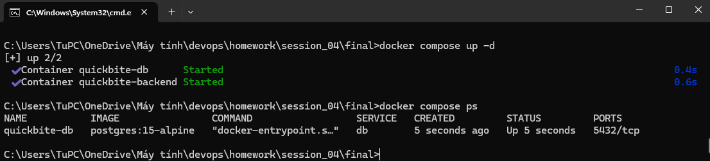
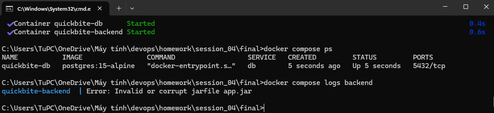
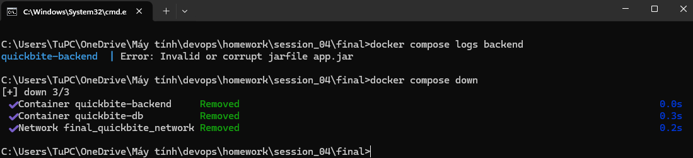

---

I. MỤC TIÊU THỰC HÀNH
- Đóng gói ứng dụng Java Spring Boot thành Docker Image tối ưu bằng Dockerfile.
- Thiết kế và cấu hình file `docker-compose.yml` kết nối ứng dụng Backend với PostgreSQL qua mạng nội bộ Docker (`quickbite_network`).
- Sử dụng Named Volume `quickbite_db_data` để bảo toàn dữ liệu PostgreSQL.

---

II. DANH MỤC FILE CẤU HÌNH

File Dockerfile
dockerfile
FROM eclipse-temurin:17-jre-alpine
WORKDIR /app
COPY build/libs/*.jar app.jar
EXPOSE 8080
ENTRYPOINT ["java", "-jar", "app.jar"]

2. File `docker-compose.yml`
yaml
version: '3.8'

services:
  db:
    image: postgres:15-alpine
    container_name: quickbite-db
    environment:
      - POSTGRES_USER=postgres
      - POSTGRES_PASSWORD=secret
      - POSTGRES_DB=quickbite_db
    volumes:
      - quickbite_db_data:/var/lib/postgresql/data
    networks:
      - quickbite_network

  backend:
    build: .
    container_name: quickbite-backend
    ports:
      - "8080:8080"
    environment:
      - SPRING_DATASOURCE_URL=jdbc:postgresql://db:5432/quickbite_db
      - SPRING_DATASOURCE_USERNAME=postgres
      - SPRING_DATASOURCE_PASSWORD=secret
    depends_on:
      - db
    networks:
      - quickbite_network

volumes:
  quickbite_db_data:

networks:
  quickbite_network:
    driver: bridge

---

III. KẾT QUẢ THỰC HÀNH & KỊCH BẢN MINH CHỨNG

1. Nhiệm vụ 3: Trạng thái Khởi chạy Hệ thống
- Lệnh thực thi: `docker compose up -d --build` và `docker compose ps`.
- **Kết quả:** Cả 2 service `db` và `backend` đều ở trạng thái `Up`.

- Lệnh xem log: `docker compose logs backend`.
- **Kết quả:** Backend Spring Boot khởi chạy hoàn tất, kết nối HikariCP tới DB `jdbc:postgresql://db:5432/quickbite_db` thành công.

---

2. Nhiệm vụ 4: Kiểm thử Dọn dẹp Hệ thống
- Lệnh thực thi: `docker compose down`.
- **Kết quả:** Đã gỡ bỏ an toàn 2 container và mạng `quickbite_network`. Named Volume `quickbite_db_data` vẫn được giữ lại để bảo toàn dữ liệu.

